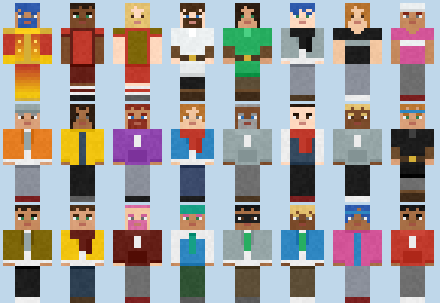

# Nicks — nickname + live skin identity replacement (Fabric, Minecraft 1.21.11, Java 21)

An admin runs `/nicks set Player123 ShadowWolf`. The tab list, nametag, chat, death messages, `/msg`, advancement and
join/leave messages now say **ShadowWolf**, and the player's actual skin becomes ShadowWolf's official skin if that
Minecraft account exists, otherwise a unique generated one. No death, respawn, reconnect or restart is needed. The real
UUID, account, inventory, permissions, stats and player data are never touched.



## Read this first: what is and is not verified

I wrote this without access to the 1.21.11 jars, Yarn mappings or Gradle's network, so:

| Part | Status |
|---|---|
| `dev.nicks.core` — identity manager, persistence, Mojang resolver, skin download/validation/legacy conversion, procedural skin generator, fictional-skin registry, nickname generator, skin pipeline | **Implemented and tested.** 55 unit tests, run 6 times in a row, all passing (JDK 21, against a minimal JUnit shim because Gradle/JUnit could not be downloaded; the tests are standard JUnit 5 and will run under `gradle test`). Generated skins were rendered and visually inspected. |
| `dev.nicks` Minecraft layer — commands, service, networking, mixins, client registry | **Implemented, compiled only against hand-written API stubs.** That proves my classes agree with each other, **not** that the real 1.21.11 signatures match. Never run in a game. |
| Multiplayer behaviour (two clients, tracking range, spectator, dimension change...) | **Not tested.** |

Expect a few small compile errors on first build. They are confined to the spots below (each marked `VERIFY ON 1.21.11`
in the source). Paste the compiler output back and they are quick fixes.

| File | Why it may need a touch |
|---|---|
| `compat/SkinCompat.java` | `SkinTextures` constructor changed in 1.21.2, 1.21.5 and 1.21.9 (history is in the comment) |
| `compat/TextureCompat.java` | `NativeImageBackedTexture` constructor (looked up by signature, 3 variants tried) |
| `compat/PermissionCompat.java` | command permission API was reworked around 1.21.9–1.21.11 (old form in the comment) |
| `compat/ProfileCompat.java` | `GameProfile` `name()/id()` vs `getName()/getId()` |
| `mixin/PlayerEntityMixin` | target `PlayerEntity#getName` |
| `mixin/ServerPlayerEntityMixin` | target `getPlayerListName` |
| `mixin/PlayerManagerMixin` | target `getPlayer(String)` |
| `mixin/client/PlayerListEntryMixin` | targets `getSkinTextures` / `getProfile` |

Mixins are `require = 1` on purpose, so a wrong target fails loudly at startup, never silently. The only optional one is
`ClientCommandSourceMixin` (nickname tab-completion in the client).

## How it works

| Feature | Mechanism |
|---|---|
| Chat, death/advancement/join/leave messages, `/msg`, team chat | One mixin on `PlayerEntity#getName`. All of these are built from `getDisplayName()`, which decorates `getName()` with team prefix/suffix/colour. Signed-chat data is untouched: only the display Text changes. |
| Tab list | `ServerPlayerEntity#getPlayerListName` returns the team-decorated nickname; identity changes send vanilla `UPDATE_DISPLAY_NAME`. No fake entries, UUID/ping/game mode/listed flag untouched. |
| Nametag | Same `getName` hook on the **client**, so the real vanilla nametag renderer shows it (no extra floating text entity). |
| Skin | Client mixin on `PlayerListEntry#getSkinTextures`, read every frame by the renderer, tab list and chat heads, so a change shows on the next frame. Texture is registered dynamically; capes are dropped so a nicknamed identity doesn't leak the real player's cape. |
| Commands | `PlayerManager#getPlayer(String)` falls back to the nickname registry, so `/tp ShadowWolf`, `/gamemode creative ShadowWolf`, `/give`, `/effect`, `/kill`, `/clear`, `/team join` ... work. Ambiguous nicknames never resolve. |
| Sync | S2C payloads `nicks:identity_sync` and `nicks:skin_texture`. Server-authoritative, revisioned, texture sent before the identity that uses it, **no C2S payload exists**, so clients cannot change anyone's identity. |
| Async | Mojang lookups, texture downloads, skin generation and file IO run off the tick. Each request carries a generation number: a newer command for the same player makes older results stale and they are discarded. Disconnected players are handled (identity saved, no packets). |

Official skins are downloaded **by the server** (HTTPS only, host allow-list `textures.minecraft.net`, size and dimension
limits, 64x32 legacy skins converted exactly like vanilla) and sent to clients as a normalized PNG, so clients never
contact arbitrary URLs.

## Install
Server **and** every client need the mod (Fabric API required). Clients without it still see all name changes
(tab list, chat, messages) but not the custom skin or nametag; the admin sees how many clients were synced.

## Build
1. Copy `minecraft_version / yarn_mappings / loader_version / loom_version / fabric_version` from the `gradle.properties` of a
   1.21.11 project that already builds for you (mine are guesses).
2. Use the same Gradle version as that project. The workflow in `.github/workflows/build.yml` is set to `9.8.0` (what your
   Loom 1.19 needed) and builds with `gradle build --no-daemon`, like your other mods. No wrapper is included.
3. Jar: `build/libs/nicks-1.0.0.jar`.

## Commands (admin; gamemaster level)
Targets accept `@a @p @s @r`, player names and nicknames.

```
/nicks random <targets>                  unique readable random names (dirtboi7, toast3r, p1xelcat ...)
/nicks set <targets> <nickname>          nickname + matching skin (real account => official, else fictional)
/nicks skin set <targets> [source]       skin of a real account; no source = skin for the current name
/nicks nicknoskin set <targets> <nick>   nickname only, skin untouched, no lookups
/nicks reset <targets>                   original name and skin back (history kept)
/nicks info <targets>   /nicks history <targets>
/nicks skin refresh <targets>            re-fetch official skin / re-sync
/nicks skin reroll <targets> [force]     new fictional skin, same nickname
/nicks skin lock|unlock <targets>        locked: nickname commands never change the skin
/nicks reload                            config, nickname pools, skin assets (keeps old settings if the file is invalid)
```
A Mojang outage never makes a real account fictional: the result is `UNRESOLVED`, the previous identity is kept and the
admin is told.

## Variety: practically unlimited skins and names
Literal infinity is impossible (Minecraft names are capped at 16 characters, skins at 64x64 pixels), but neither supply runs out:

* **Skins:** every 64-bit seed is a different character: 8 outfits, 7 hair styles, 5 accessories, face variants, procedurally
  drawn emblems/numbers, and **continuous** colours (hue/saturation/brightness come from the seed, no fixed palette).
  Tests assign 2,500 skins with no repeated texture or look, and 6,000 specs give ~6,000 distinct looks. When the optional
  PNG library (`config/nicks/skin_assets/`, `name.png` / `name.slim.png`) is used up, generation continues.
* **Names:** word pools + leetspeak first, then an endless pronounceable-word generator with digits. Tests produce 30,000
  unique valid names; tiny custom pools still work. Replace/extend pools in `config/nicks/nickname_pools/`
  (`prefixes.txt`, `suffixes.txt`, any other `*.txt` = ready-made names). Offensive fragments are filtered.

## Files
`config/nicks/config.json` (rewritten with all options on load), `nickname_pools/`, `skin_assets/`.
Per world, in `<world>/nicks/`: `identities.json` (schema-versioned, atomic writes, `.bak`, corrupt files quarantined,
newer schemas loaded read-only and never overwritten), `fictional_skins.json`, `skin_cache/`. Nickname history is stored
inside `identities.json`. No credentials or tokens are ever read or stored.

## Public API (`dev.nicks.api`)
`NicksApi`: `getIdentity / getOriginalUsername / getNickname / getDisplayName / getSkinSource / getIdentityType`,
`setNickname / setSkin / resetIdentity` (same validation, locks and sync as the commands; futures complete on the server
thread), `registerSkinProvider(prefix, provider)`. `NicksEvents`: before/after nickname change, skin change, identity reset
(before-events can veto).

## Known limitations
* Vanilla clients cannot see custom skins or the replaced nametag (the server cannot make an unmodified client render a new
  skin; names in tab list/chat/messages do work for them).
* `@a[name=Player123]` now matches the nickname (selectors use the displayed name); the real name still works as a literal player name.
* The server console log shows nicknames in some lines (`X lost connection`).
* Third-party commands with their own player argument type are not covered unless they go through `PlayerManager#getPlayer(String)`.
* Team colour changes made *after* a nickname was applied update the tab-list entry on the next identity change/join.

## Not implemented
* Scoreboard display replacement (scores are keyed by the real name; overriding per-score display text would fight datapacks).
* Nickname-based tab sorting (the client sorts by profile name).
* Boss bars (vanilla boss bars do not show player names).
* Offline-mode servers and proxies were not tested.

## In-game test plan (not run yet)
1. Two clients A, B. As op: `/nicks set A Notch` → both see Notch's skin (classic) and name in tab/nametag/chat; `/nicks set A Dream` or any real slim account → slim arms.
2. `/nicks set A ToastBuilder` → generated skin; `/nicks set B ShadowWolf99` → a different one; restart server → unchanged.
3. `/nicks nicknoskin set A Foo` keeps the skin; `/nicks skin set A Notch` keeps the name; switch A → B → A skins repeatedly.
4. `/tp Foo B`, `/gamemode creative Foo`, `/give Foo diamond`; die by a mob and by B; `/msg Foo hi`; `/nicks reset A`.
5. Join a third client late; leave and re-enter render distance; change dimension, game mode, spectate A.
6. Cut the network (or block `api.minecraftservices.com`) and run `/nicks set A Notch` → red message, old identity intact.
7. Check inventory, UUID (`/data get entity A UUID`), advancements and stats are unchanged.
